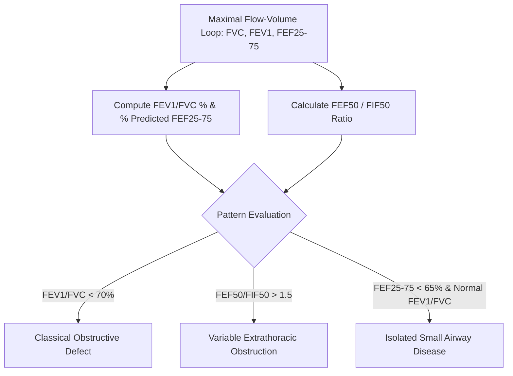

# Pulmonary Dynamic Flow-Volume Loop (FEF25-75) Skill

[](LICENSE)
[](https://www.python.org/)
[](https://openclaw.org/)
[](https://alphapark.ai/)
[](https://modelcontextprotocol.io/)

Dynamic Spirometry Flow-Volume Loop and Maximum Mid-Expiratory Flow ($\text{FEF}_{25-75\%} / \text{MMEF}$) Analyzer based on respiratory mechanics.



## Features
- **Zero PIP Dependencies**: Implemented strictly with Python Standard Library (`math`, `json`, `sys`, `typing`).
- **Small Airway Sensitivity**: Detects subtle peripheral bronchiolar narrowing overlooked by standard $\text{FEV}_1$.
- **Anatomical Differential**: Discriminates extrathoracic vs intrathoracic upper airway limitations.
- **Dual Architecture**: Native Python import and Model Context Protocol (MCP) JSON-RPC 2.0 stdio server.

## Quickstart
```bash
python example_usage.py
```

## License
Apache-2.0
